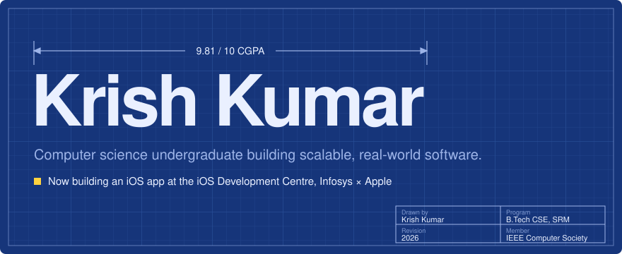
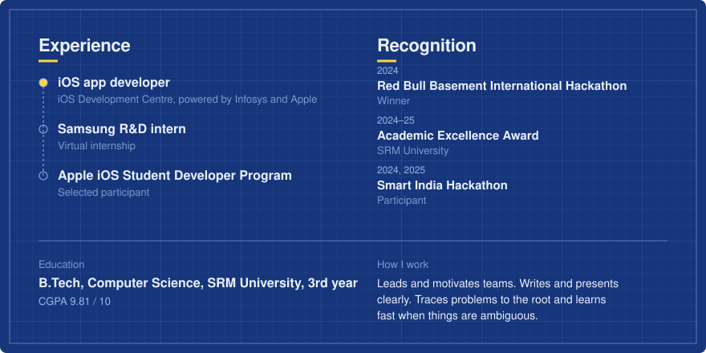
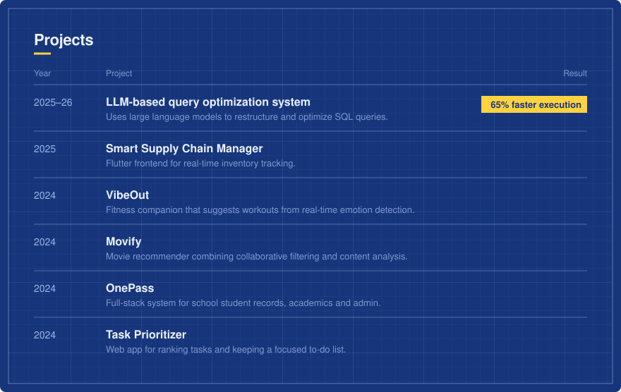
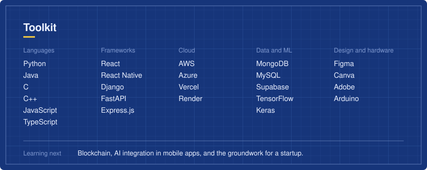

  
  

  

  <a href="https://portfolio2-three-lime.vercel.app/">Portfolio</a>&nbsp;&nbsp;&nbsp;
  <a href="https://www.linkedin.com/in/krish-kumar-1a119728a/">LinkedIn</a>&nbsp;&nbsp;&nbsp;
  <a href="https://instagram.com/__krish___2005">Instagram</a>

Open to building something together. The quickest way to reach me is on <a href="https://www.linkedin.com/in/krish-kumar-1a119728a/">LinkedIn</a>.

