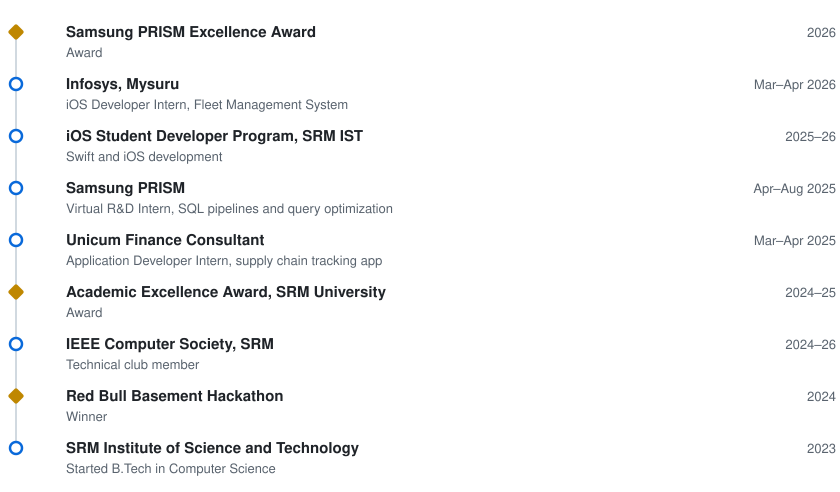

  
  

<picture>
  <source media="(prefers-color-scheme: dark)" srcset="assets/header-dark.svg">
  
</picture>

I study computer science at SRM University, Chennai (2023–2027), and I build iOS apps, data pipelines and ML systems. Most recently I was an iOS Developer Intern at Infosys, working on a fleet management system.

[Portfolio](https://portfolio2-three-lime.vercel.app/) · [LinkedIn](https://www.linkedin.com/in/krish-kumar-1a119728a/) · [Instagram](https://instagram.com/__krish___2005)

  

## Timeline

<picture>
  <source media="(prefers-color-scheme: dark)" srcset="assets/timeline-dark.svg">
  
</picture>

## Experience

<b>Infosys</b>, iOS Developer Intern, Mysuru, Mar–Apr 2026

 

- Built features for a fleet management system, turning business requirements into technical solutions with structured data handling and API integration.
- Improved data retrieval and app responsiveness through data quality checks, structured pipelines and performance testing.
- Worked in an Agile team with sprint reviews and code reviews.

<b>Samsung PRISM</b>, Virtual R&D Intern, Chennai, Apr–Aug 2025

 

- Designed and analysed SQL data pipelines, finding database bottlenecks through query analysis and indexing strategies.
- Used statistical analysis and preprocessing to study query execution patterns and improve execution efficiency.
- Built data quality frameworks and optimization tooling.

<b>Unicum Finance Consultant</b>, Application Developer Intern, Chennai, Mar–Apr 2025

 

- Built an inventory and product tracking app for supply chain distribution channels.
- Added data visualization components and reporting dashboards for business decisions.
- Worked with stakeholders to map supply chain workflows and deliver on time.

## Projects

<b>LLM-Powered SQL Query Optimization</b>, 2025–26. Python, SQL, MySQL, NLP, ML

 

- End-to-end pipeline that uses NLP and a large language model to suggest SQL query improvements, trained on 10,000 examples.
- Automates query rewriting and indexing recommendations with ML and regression analysis.
- Across 500+ test queries, average execution time dropped by **32%**.

<b>ThreatSense</b>, multi-modal scam detection, 2024. Python, FastAPI, Next.js, ML

 

- Classifies fraudulent messages and phishing URLs with ML models and NLP feature extraction.
- Statistical risk scoring with an interactive dashboard for reviewing detections.

<b>VibeOut</b>, emotion-aware fitness platform, 2024. React, Flask, OpenCV, TensorFlow

 

- Real-time facial expression analysis with OpenCV and TensorFlow feeds a personalized workout recommender.
- React frontend on a Flask API, with voice and visual input to improve prediction accuracy.

<b>ParentBud</b>, iOS app, 2025. Swift

 

- Data structures for profiles, behaviour tracking and activity logs to forecast child development milestones.
- Daily check-ins and progress dashboards for parents.

More projects

 

| Project | What it is | Year |
|---|---|---|
| MindHeaven | iOS app for meditation and breathing exercises | 2025 |
| CancerBlog | Website for research, case studies and clinical trial updates | 2024 |
| IEEE CS SRMIST website | Club website with event management | 2023 |
| Smart Task Prioritizer | Productivity and task management tool | 2023 |

## Awards and certifications

| Awards | Certifications |
|---|---|
| Samsung PRISM Excellence Award, 2026 | AWS Certified AI Practitioner |
| Academic Excellence Award, SRM University, 2024–25 | GitHub Foundations |
| Performance-based scholarship, 3rd year | SAP Data Analytics Cloud |
| Red Bull Basement Hackathon winner, 2024 | HackerRank Python (Basic) |
| Smart India Hackathon internal winner | Beginning C++ |

Full skill list

 

**Core subjects:** data structures and algorithms, DBMS, operating systems, computer networks, statistics and probability  
**Programming:** Python, SQL, C, C++, JavaScript, Swift  
**Data and analytics:** preprocessing, pipelines, data quality, statistical modeling, regression, forecasting, visualization  
**Databases:** MySQL, SQL Server, indexing, SAP ERP (exposure)  
**AI and ML:** NLP, TensorFlow, OpenCV, Hugging Face, OpenAI, generative and agentic AI  
**Web and mobile:** React, Next.js, Node.js, Flask, HTML/CSS, Xcode  
**Tools:** Git, GitHub, API integration, Agile, dashboards

