<picture>
  <source media="(prefers-color-scheme: dark)" srcset="assets/hero-dark.svg">
  
</picture>

I'm in my B.Tech (2023–2027) and I build iOS apps, data pipelines and ML systems. Most recently I was an iOS Developer Intern at Infosys, working on a fleet management system.

[Portfolio](https://portfolio2-three-lime.vercel.app/) · [LinkedIn](https://www.linkedin.com/in/krish-kumar-1a119728a/) · [Instagram](https://instagram.com/__krish___2005)

  

## Experience

**iOS Developer Intern, Infosys** Mysuru, Mar–Apr 2026 
Built features for a fleet management system, with structured data handling, API integration and performance testing in an Agile team.

**Virtual R&D Intern, Samsung PRISM** Chennai, Apr–Aug 2025 
Analysed SQL pipelines to find database bottlenecks, and built data quality and query optimization tooling.

**Application Developer Intern, Unicum Finance Consultant** Chennai, Mar–Apr 2025 
Built an inventory and product tracking app with reporting dashboards for supply chain teams.

##  Projects

<table>
<tr>
<td width="50%" valign="top">

**LLM-Powered SQL Query Optimization** 
An NLP and LLM pipeline that rewrites SQL queries and recommends indexes. Average execution time dropped 32% across 500+ test queries. 
Python, SQL, MySQL, NLP, ML. 2025–26

</td>
<td width="50%" valign="top">

**ThreatSense** 
Detects scam messages and phishing URLs with ML and NLP features, scored by a statistical risk model with a review dashboard. 
Python, FastAPI, Next.js, ML. 2024

</td>
</tr>
<tr>
<td width="50%" valign="top">

**VibeOut** 
A fitness app that reads facial expressions in real time with OpenCV and TensorFlow and recommends workouts to match. 
React, Flask, OpenCV, TensorFlow. 2024

</td>
<td width="50%" valign="top">

**ParentBud** 
An iOS app for parents with daily check-ins, activity logs and progress dashboards that track child development milestones. 
Swift, iOS. 2025

</td>
</tr>
</table>

Also built: MindHeaven, a meditation app for iOS (2025). CancerBlog, a research and clinical trials site (2024). The IEEE CS SRMIST club website (2023). Smart Task Prioritizer (2023).

## Recognition

<table>
<tr>
<td width="50%" valign="top">

**Awards**
- Samsung PRISM Excellence Award, 2026
- Academic Excellence Award, SRM University, 2024–25
- Performance-based scholarship, 3rd year
- Red Bull Basement Hackathon winner, 2024
- Smart India Hackathon internal winner

</td>
<td width="50%" valign="top">

**Certifications**
- AWS Certified AI Practitioner
- GitHub Foundations
- SAP Data Analytics Cloud
- HackerRank Python (Basic)
- Beginning C++

</td>
</tr>
</table>

Member of the iOS Student Developer Program at SRM IST (2025–26) and the IEEE Computer Society, SRM (2024–26).

Full skill list

 

**Core subjects:** data structures and algorithms, DBMS, operating systems, computer networks, statistics and probability  
**Programming:** Python, SQL, C, C++, JavaScript, Swift  
**Data and analytics:** preprocessing, pipelines, data quality, statistical modeling, regression, forecasting, visualization  
**Databases:** MySQL, SQL Server, indexing, SAP ERP (exposure)  
**AI and ML:** NLP, TensorFlow, OpenCV, Hugging Face, OpenAI, generative and agentic AI  
**Web and mobile:** React, Next.js, Node.js, Flask, HTML/CSS, Xcode  
**Tools:** Git, GitHub, API integration, Agile, dashboards

