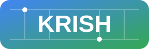
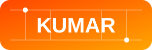

<picture>
  <source media="(prefers-color-scheme: dark)" srcset="assets/header-dark.svg">
  
</picture>

I'm a computer science undergraduate who builds scalable, real-world software, mostly through hackathons and side projects. Right now I'm building an iOS app at the iOS Development Centre, powered by Infosys and Apple.

[Portfolio](https://portfolio2-three-lime.vercel.app/) · [LinkedIn](https://www.linkedin.com/in/krish-kumar-1a119728a/) · [Instagram](https://instagram.com/__krish___2005)

### Experience

- **iOS app developer**, iOS Development Centre (Infosys × Apple). Current.
- **Samsung R&D intern**, virtual internship.
- **Apple iOS Student Developer Program**, participant.
- **IEEE Computer Society**, member.

### Recognition

| Year | |
|---|---|
| 2024 | Winner, Red Bull Basement International Hackathon |
| 2024–25 | Academic Excellence Award, SRM University |
| 2024, 2025 | Participant, Smart India Hackathon |

### Projects

| Project | What it does | Year |
|---|---|---|
| **LLM query optimizer** | Uses large language models to rewrite SQL queries. Execution is 65% faster. | 2025–26 |
| **Smart Supply Chain Manager** | Flutter frontend for real-time inventory tracking. | 2025 |
| **VibeOut** | Suggests workouts based on real-time emotion detection. | 2024 |
| **Movify** | Movie recommender using collaborative and content-based filtering. | 2024 |
| **OnePass** | Full-stack system for school records, academics and admin. | 2024 |
| **Task Prioritizer** | Web app for ranking tasks and keeping a focused to-do list. | 2024 |

### Toolkit

**Languages:** Python, Java, C, C++, JavaScript, TypeScript  
**Frameworks:** React, React Native, Django, FastAPI, Express.js  
**Cloud:** AWS, Azure, Vercel, Render  
**Data and ML:** MongoDB, MySQL, Supabase, TensorFlow, Keras  
**Design and hardware:** Figma, Canva, Adobe, Arduino

### Education

B.Tech in Computer Science, SRM University, 3rd year, CGPA 9.81 / 10.

Learning next

 
Blockchain, AI features in mobile apps, and the groundwork for my own startup.

  
  

